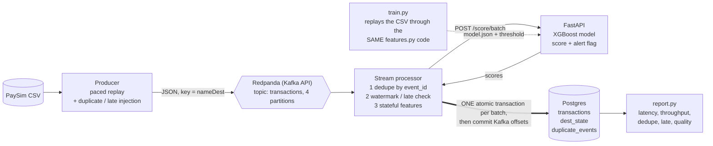

# Real-time fraud pipeline: streaming, stateful features, model serving

[](https://github.com/charanteja101/realtime-fraud-detection-pipeline/actions)

**Live demo (scoring API):** [https://realtime-fraud-detection-pipeline.onrender.com/docs](https://realtime-fraud-detection-pipeline.onrender.com/docs)
(free tier: the first request after idle can take about a minute to wake up)


PaySim transactions are replayed as a live event stream, enriched with **incrementally computed
destination-account history**, scored by an **XGBoost model behind FastAPI**, and landed in
Postgres, with measured latency/throughput and explicit handling of **duplicate and late events**.

> **Note:** this is an educational / portfolio project built on simulated data. See the [Disclaimer](#disclaimer) at the end.



| Requirement | Where it lives |
|---|---|
| Ingest: producer to Kafka, consumer lands in Postgres | `producer.py`, `processor.py`, `store.py`, `schema.sql` |
| Features computed incrementally, not in a batch pandas pass | `features.py` (per-account state, 24h sliding window) |
| Serve: FastAPI loads XGBoost, returns score + alert flag | `api.py`, `model.py` |
| Ship: Docker Compose, GitHub Actions, diagram | `docker-compose.yml`, `.github/workflows/ci.yml`, this file |
| Measure: latency, throughput, late/duplicate handling | `report.py`, `bench_api.py`, `producer.py --dup-rate/--late-rate` |

## Quick start

Prerequisites: Docker with Compose v2. (`make` is optional; every target below is a plain
`docker compose` command shown in the `Makefile`.)

**1. Get the data** (not included, it is ~470 MB and Kaggle-licensed). Download
[PaySim](https://www.kaggle.com/datasets/ealaxi/paysim1) and put the CSV in `data/`:

```
data/PS_20174392719_1491204439457_log.csv
```

No Kaggle account handy? Generate a small PaySim-shaped file instead and use it everywhere below
with `DATA_FILE=sample.csv`:

```bash
make sample          # writes data/sample.csv (50k rows)
```

**2. Train the model** (replays the CSV through the online feature code; about a minute on the full file):

```bash
make train                       # or: make train DATA_FILE=sample.csv
```

This writes `models/model.json` (XGBoost) and `models/model_meta.json` (feature order, alert
threshold, test metrics).

**3. Start the stack, replay, measure:**

```bash
make up                          # redpanda + postgres + api + processor
RATE=800 make replay-messy       # 800 events/s, 2% duplicates, 2% late events
make report                      # latency, throughput, dedupe, late counts, precision/recall
```

**No `make` (Windows PowerShell)?** Every target is a plain `docker compose` command:

```powershell
docker compose build
docker compose run --rm tools python -m fraudstream.synth --rows 50000 --out /data/sample.csv
docker compose run --rm tools python -m fraudstream.train --data /data/sample.csv
docker compose up -d --build --wait redpanda postgres api processor

$env:DATA_FILE = "sample.csv"; $env:RATE = "800"; $env:DUP_RATE = "0.02"; $env:LATE_RATE = "0.02"
docker compose run --rm producer
docker compose run --rm tools python -m fraudstream.report --wait --expect 50000

docker compose --profile replay --profile tools down -v      # wipe everything for a fresh run
```

Useful knobs (environment variables, see `docker-compose.yml`): `RATE` (events/s, `0` =
unthrottled for a throughput test), `LIMIT` (first N rows), `DUP_RATE`, `LATE_RATE`,
`LATE_STEPS`, `RUN_ID`.

Try the API directly:

```bash
curl -s localhost:8000/model | head -c 400
curl -s localhost:8000/score -H 'content-type: application/json' -d '{"features": {
  "hour_of_day":10,"type_code":4,"amount":181000,"old_balance_orig":181000,"new_balance_orig":0,
  "old_balance_dest":0,"new_balance_dest":0,"err_balance_orig":0,"err_balance_dest":181000,
  "orig_drained":1,"amount_eq_old_balance":1,"dest_is_merchant":0,"dest_txn_count":0,
  "dest_total_in":0,"dest_avg_amount":0,"dest_max_amount":0,"dest_transfer_count":0,
  "dest_steps_since_last":-1,"dest_txn_count_24h":0,"dest_amount_24h":0,"amount_to_dest_avg":181000}}'
# interactive docs: http://localhost:8000/docs
```

Replaying the same file twice with the same `RUN_ID` makes every event a duplicate (that is the
point of idempotent ingestion). For a fresh run use `make reset` (deletes the Docker volumes) or
set a new `RUN_ID`.

### Bring your own XGBoost model

Put your Booster in `models/model.json` (`booster.save_model("models/model.json")`) and a
`models/model_meta.json` such as:

```json
{"version": "my-model-1", "threshold": 0.8, "feature_order": ["amount", "type_code", "dest_txn_count_24h"]}
```

`feature_order` must be a subset of the names in `FEATURE_ORDER` (`fraudstream/features.py`);
the API selects those columns by name, in that order. Add new features by extending
`features.py`, which changes training and serving together.

## How it works

**Partitioning.** Events are keyed by `nameDest`, so all history for one destination account
lives on one partition and is handled in order by one consumer. That is what makes per-account
state safe to update incrementally.

**Stateful features** (`features.py`). Two functions, used by both training and serving:
`feature_vector(txn, state)` reads the destination's state *before* the event, then
`update_state(state, txn)` folds the event in. Per account it keeps lifetime count/sum/max,
transfer count, last step, and 24 hourly buckets for a sliding window. Everything is a
commutative aggregate, so out-of-order events inside the lateness bound converge to the same
state. State is stored as JSONB in Postgres (`dest_state`) and loaded per batch.

**No train/serve skew.** `train.py` does not use pandas group-bys. It replays the CSV in step
order through the same two functions. `tests/test_train_parity.py` asserts the offline matrix
equals what the streaming processor produces, across arbitrary batch boundaries. Splits are
chronological (70/10/20) and the alert threshold is chosen on the validation slice (highest
recall at precision >= 0.9 by default).

**Effectively-once landing.**
1. `event_id` is the primary key of `transactions`.
2. Per batch, the processor writes transactions, state updates and the duplicate log in **one
   Postgres transaction**.
3. Kafka offsets are committed only **after** that commit.

If it crashes anywhere, the batch is redelivered and recognised as duplicates, so state is never
applied twice. If scoring or the DB is down, the same batch is retried and nothing partial is
written.

**Duplicates.** Re-sent events (same `event_id`) are dropped, never rescored, and logged to
`duplicate_events`.

**Late events.** The processor tracks a watermark (max `step` seen). An event more than
`ALLOWED_LATENESS_STEPS` (default 6) behind it is *late*: it is still scored and landed
(`is_late = true`) but does not update account state. Within the bound it is applied normally.
The producer's `--late-rate/--late-steps` generates such events by holding them back and
releasing them after newer steps have already been sent.

**Latency stamps** stored per row: `produced_ms`, `consumed_ms`, `scored_ms`, `landed_ms`.
`report.py` turns them into p50/p95/p99 for end-to-end and per stage.

## Results

Measured on: _<CPU / RAM>_, Docker Desktop (WSL2), one processor, 4 partitions, one API container
with 2 workers. Data: 50,000 synthetic PaySim-schema events (`fraudstream.synth`), with 2% duplicate
and 2% late events injected, lateness bound 6 steps. Latency = producer send to just before the
database commit (the commit itself is not included).

| Scenario | Throughput | End-to-end p50 / p95 / p99 | Time in Kafka (p50) | Features + scoring (p50) |
|---|---|---|---|---|
| **Paced at 800 ev/s** | 784 ev/s sustained | **117 / 216 / 394 ms** | 81 ms | 33 ms |
| Overload: offered 2,000 ev/s | ~1,330 ev/s sustained (backlog grows) | 6.1 s / 11.8 s / 12.1 s | 6.1 s | 71 ms |
| API alone (`bench_api`) | _not yet measured_ | _not yet measured_ | | |

Correctness over the paced run: **50,000 / 50,000** unique events landed, **990 / 990** injected
duplicates dropped, **479** late events flagged (the rest of the 970 held-back events arrived
inside the 6-step tolerance and were applied normally).

What the two runs show:

- **Capacity.** This setup sustains roughly 1,300 ev/s. Offered load above that builds a backlog
  in Kafka instead of dropping data: every event still landed, but queueing pushed latency from
  about 120 ms to several seconds. Latency is only meaningful below saturation, so the paced run is
  the one to quote.
- **Where the time goes.** Of the 117 ms median, about 81 ms is time between produce and consume,
  which includes the broker and the processor's batch-collection wait (up to `FETCH_WAIT_S`, 50 ms
  by default). Feature computation plus the HTTP scoring call for a batch is about 33 ms.
- **Late counts depend on keeping up.** The overload run flagged 731 late events versus 479 when
  paced, because a lagging consumer sees steps in a skewed order. Late-event metrics should also
  be read at a sustainable rate.
- **Alert quality here is not a model claim.** Precision 0.96 / recall 0.998 on the replay come
  from synthetic data the model was trained on. Held-out metrics are printed by `train` and saved in
  `models/model_meta.json`; use the real PaySim file for numbers worth quoting.

Reproduce:

```powershell
docker compose --profile replay --profile tools down -v
docker compose up -d --wait redpanda postgres api processor
$env:DATA_FILE = "sample.csv"; $env:RATE = "800"; $env:DUP_RATE = "0.02"; $env:LATE_RATE = "0.02"
docker compose run --rm producer
docker compose run --rm tools python -m fraudstream.report --wait --expect 50000
docker compose run --rm tools python -m fraudstream.bench_api --url http://api:8000
```

## Live deployment

The model-serving API is deployed from `Dockerfile.api` (the trained model is baked into the image)
and runs at [https://realtime-fraud-detection-pipeline.onrender.com](https://realtime-fraud-detection-pipeline.onrender.com):

| Path | What it does |
|---|---|
| `/docs` | interactive page: try `POST /score` with the sample JSON from the quick start |
| `/health` | liveness check and loaded model version |
| `/model` | feature list and alert threshold |
| `/score`, `/score/batch` | score one or many feature vectors, returns score + alert flag |

Only the scoring API is hosted. The streaming stack (Redpanda, processor, Postgres) is run locally
with Docker Compose. `/score` takes the 21 computed features rather than a raw transaction, because the
per-account history features come from the stream processor's stored state.

To deploy your own copy: push the repo (force-add `models/model.json` and `models/model_meta.json`,
they are git-ignored), create a Docker web service on a host such as Render, set the Dockerfile path
to `Dockerfile.api` and the health check path to `/health`.

## Tests and CI

```bash
pip install -r requirements.txt -r requirements-dev.txt
pytest                      # unit tests; Postgres tests run if TEST_DATABASE_URL is set
ruff check .
```

| Test file | What it proves |
|---|---|
| `test_features.py` | history is point-in-time correct, window slides/prunes, out-of-order events converge, JSON round-trip |
| `test_processor.py` | batch size does not change results; duplicates dropped; late events flagged and state untouched; bad events rejected; failed batch leaves no trace |
| `test_train_parity.py` | offline training features equal online features |
| `test_producer.py` | duplicate/late injection loses nothing and really is late |
| `test_api.py` | trains a tiny model, checks `/score`, `/score/batch`, alert flag, 422 on missing features |
| `test_store_postgres.py` | real Postgres: atomic write, dedupe, late flag, state round-trip |

GitHub Actions (`.github/workflows/ci.yml`) runs lint + tests with a Postgres service, then an
**end-to-end job** that builds the images, trains on synthetic data, brings up Redpanda +
Postgres + API + processor, replays 30,000 events with duplicates and late events injected, and
fails unless exactly 30,000 unique events landed and both the dedupe and late paths fired.

## Layout

```
fraudstream/
  features.py    incremental features + state (shared by training and serving)
  train.py       replay-based feature build, chronological split, XGBoost, threshold
  api.py         FastAPI: /score, /score/batch, /health, /model
  model.py       Booster loading, feature matrix assembly
  producer.py    paced CSV replay + duplicate/late injection
  processor.py   consume, dedupe, watermark, features, score, atomic land, commit
  store.py       PostgresStore + MemoryStore (same interface), schema.sql
  report.py      latency / throughput / dedupe / late / quality from Postgres
  bench_api.py   scoring endpoint load test
  synth.py       PaySim-shaped synthetic data for CI and smoke tests
```

## Design trade-offs and limits

- **State in Postgres JSONB** keeps the stack small and makes the landing transaction atomic.
  At higher scale you would move hot state to Redis/RocksDB (or use Flink / Kafka Streams state
  stores) and accept a more complex exactly-once story.
- **One consumer** is the default. Scaling out is safe because keys are partitioned by
  destination, but the watermark is per process (a per-partition watermark would be the next step).
- Events inside the lateness bound may see aggregates that include slightly *newer* events than
  their own timestamp; this is a small, bounded point-in-time skew from out-of-order arrival.
- `landed_ms` is stamped just before COMMIT, so the commit itself is not in the latency numbers
  (which is why the `db_write` stage reads about 0 ms). All timestamps come from one host clock;
  across machines you would need clock-skew handling.
- PaySim is simulated and several features (balance-error checks) make it unrealistically easy
  (near-perfect PR-AUC is expected). Treat the numbers as a pipeline demo, not fraud-model
  evidence; the engineering is the point.
- Not included (natural next steps): schema registry / Avro, dead-letter topic for rejected events,
  Prometheus metrics, model registry and drift monitoring, Kubernetes manifests.

## Disclaimer

This project is provided for educational and demonstration purposes only, as a portfolio piece
showing streaming, stateful feature computation and model serving.

- **Simulated data.** It uses the PaySim synthetic dataset and a synthetic data generator. No real
  customer or transaction data is included or used. PaySim is a simulation, so metrics reported
  here do not reflect how a model would perform on real payment fraud.
- **Not production-ready.** It is not a fraud-prevention product and must not be used to make real
  decisions about payments, accounts or people. A production system would need security review,
  authentication, monitoring, model validation, compliance and privacy controls that are out of
  scope here.
- **Public demo.** The hosted API is an unauthenticated demo on a free tier. It may be slow, sleep
  when idle, change or go offline without notice. Do not send real or sensitive data to it.
- **Benchmarks.** Performance numbers were measured once on a single development machine and will
  vary with hardware and configuration.
- **Third-party data and software.** The PaySim dataset is not redistributed here; download it from
  Kaggle and follow its license terms. Software is provided "as is", without warranty of any kind
  (see `LICENSE`).
